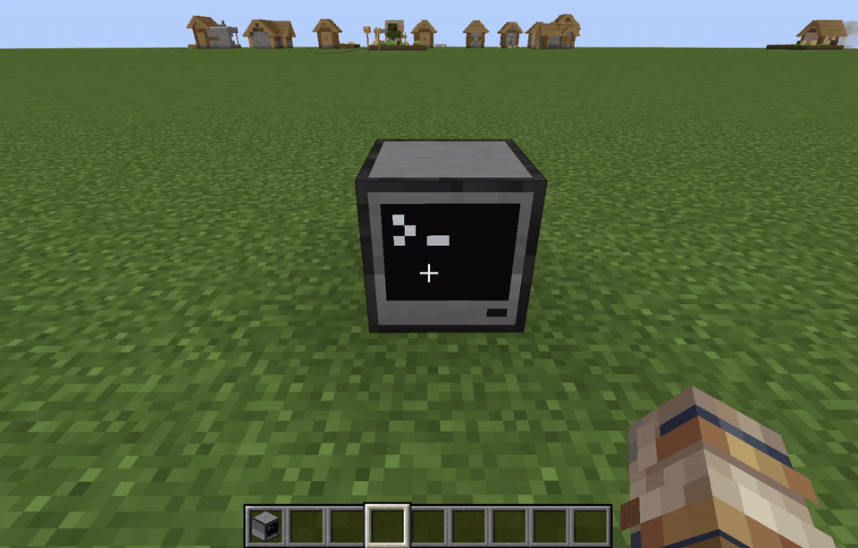

Around a year ago I began working on building an operating system for ComputerCraft. It started when I noticed the complete lack of security features in ComputerCraft, and evolved into a months-long lesson about the architecture of Linux/Unix. 

<ImageCaption>Installing v0.1.0-alpha.2 with wget, then booting into the Hecate shell.</ImageCaption>

<!-- truncate -->

For those that don't know, ComputerCraft is a mod for Minecraft that adds Lua-powered computers to the game. The computers can interact with the world in various ways, and there are "turtle" computers that can even move around and break blocks. The mod is used in a variety of ways, sometimes to create massive quarries utilizing the turtles, or in combination with other mods to act as an control system or custom dashboard for advanced automation. It's a very powerful mod in all respects, but it has one major flaw - it lacks security.

ComputerCraft computers ship with a very basic single-user operating system that lacks any access-control features. If you can interact with a computer, you can run any program, edit any file, or even just delete everything. There are no systems in place to prevent a bad actor from accessing your computer and doing anything they want with it. In single-player this is fine, but in multiplayer it could lead to an issue. So I decided I wanted to try and solve it.

From the beginning I knew I wanted to take strong cues from Unix. I daily-drive Arch Linux on my laptop so I was already somewhat familiar with its security model, but the project started off more as a sandbox than a full operating system. It ran at startup and modified the global environment, redirecting file access through its own functions that enforced access control rules. It used a layer over ComputerCraft's base filesystem, with a .inode and .dentry file that defined the owner, read, write, execute, and more for each file.

Eventually though, the plans grew beyond just a sandbox for user programs. I kept wanting to learn more about the architecture of Linux, and I kept running into limitations with the sandbox model. I restarted the project (for the first time, I'll talk about the second time in a future blog post) and wrote it from the start with the goal of it being a full OS. Not only has this unlocked a lot more potential for security features, it also now runs in plain lua, not just ComputerCraft, and it has expanded my knowledge of how Linux works. I've learned a lot about drivers and devices, the virtual file system, the user- and kernel-space divide, and more.

Now I'm getting closer to the first release version of the project. After 2 full rewrites and nearly a year of development, it has a working VFS and permissions, a driver and device system, a scheduler, a few userland utilities, and more. For now I've put out v0.1.0-alpha.2 on my GitHub, but before the full v0.1.0 release I want to add some more userland utilities and fix up some bugs that are still left in the code. Beyond v0.1.0 I still have lots of ideas for topics to explore, including pipes, block devices, proper authentication, and more. 

It's still not yet a security upgrade over the base ComputerCraft OS, but the framework is there and I'll be able to build on it now that I've mostly locked down the design. Once authentication and protection from just killing the OS is implemented, it will definitely be a step up, but there's always the risk of someone having physical access to the computer.

The source code is available on [GitHub](https://github.com/self-init/hecate) and you can find [v0.1.0-alpha.2](https://github.com/self-init/hecate/releases/tag/v0.1.0-alpha.2) on the releases page. Make sure to check the readme for instructions on how to install or run it.

Update: [v0.1.0](https://github.com/self-init/hecate/releases/tag/v0.1.0) is released! Go check it out!
