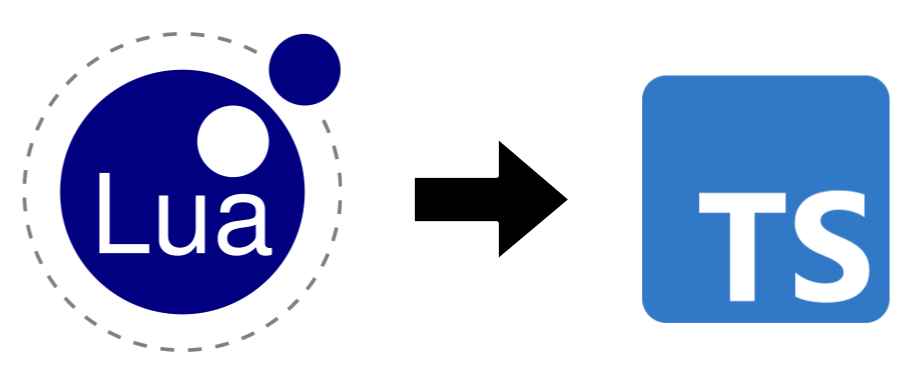

Part way through the development of [Hecate](/blog/computercraft-os) I realized I was hitting the limitations of using pure Lua. While I have been using Lua for years, this was my largest project utilizing it, and its weaknesses for something of this scale really started to show. I eventually made the decision to migrate to TypeScript, and it definitely improved the development process, but not without some bumps along the way.



<!-- truncate -->

When I first started developing Hecate, I didn't think that it would scale into the project that it is today. It started as just a simple program sandbox, and only later evolved into a full operating system. But developing an entire OS in a dynamically typed language was going to be hard to maintain, and it only became clearer that was the case as time moved on.

I've since rewritten Hecate twice: once when it turned from a sandbox to an OS, and again when I migrated to TypeScript. When Hecate grew from a sandbox to a full OS, it grew in complexity and became more object-oriented. Because Lua is dynamically typed, I struggled a lot to keep track of types and function signatures, especially since they kept changing as Hecate took shape. 

## Hitting the limits of Lua

To combat the growing complexity of Lua, I began to use LuaCATS. LuaCATS uses specially formatted comments, called type annotations, to assign types to Lua variables. This was great because ComputerCraft can only run Lua, and since these are just comments and they don't change the code at all it would work with no issues.

Well, not with *no* issues. There were some limitations to LuaCATS that made it difficult to work with. For example, LuaCATS is prone to code drift. Since the typing information is defined by the annotations, updating the code doesn't update the typing with it. And since it's just pure Lua, there's no type checking, so an incorrectly typed function will still run, but will probably lead to errors.

Futhermore, LuaCATS annotations required constant casting. When defining a new class or when using generics typing information was constantly lost and had to be re-added with type casting, which shows up as a comment at the end of the line. Part of the problem was my design, since I made a bimap with one `get` that worked in both directions. But even when I added overloads to work around it, LuaCATS couldn’t connect them to the map’s actual types, so I still had to cast.

```lua title="basefs.lua"
local parent_path = self.inode_path_map:get(parent_inode.id) --[[@as string]]
for path, _ in pairs(self.inode_path_map.forward --[[@as table<string, integer>]]) do
```

Lastly, there's just the verbosity of LuaCATS's syntax. For classes, objects, and functions, you need to add a new comment line for each function parameter, return value, or public variable. You can see in the code snippet below just how much boilerplate is needed for a single class. In many cases, the type annotations for a function would be nearly the length of the function itself.

```lua title="two_way_map.lua"
---@class TwoWayMap<K, V>
---@field forward table<K, V>
---@field backward table<V, K>
local TwoWayMap = {}

---@generic K, V
---@return TwoWayMap<K, V>
function TwoWayMap:new()
    local map = {
       	forward = {},
       	backward = {}
    }
    setmetatable(map, self)
    self.__index = self
    
    return map
end

---@generic K, V
---@param key K
---@param value V
function TwoWayMap:set(key, value)
    self.forward[key] = value
    self.backward[value] = key
end

---@generic K, V
---@overload fun(self: TwoWayMap<K, V>, key: K): V
---@overload fun(self: TwoWayMap<K, V>, key: V): K
---@param key K | V
---@return V | K
function TwoWayMap:get(key)
    if self.forward[key] ~= nil then
        return self.forward[key]
    else
        return self.backward[key]
    end
end
```

Beyond LuaCATS though, there were limitations with Lua itself. The biggest one for me being that Lua lacks almost any syntax for classes. You can make classes fairly easily, but it requires using metatables was just even more boilerplate on top of LuaCATS. And when it came to inheritance, things just got even more complicated. Navigating through a class's source code became a chore and actively slowed down development. 

## Making the choice to migrate

Eventually I'd had enough. I wanted a much more powerful typing system, and native syntax support for classes. Having to wade through boilerplate just wasn't working anymore. So I decided to migrate to another language. But it wasn't quite that simple. ComputerCraft only has a Lua runtime, there isn't a way to run other languages. So I needed something that could emit Lua code. Luckily, from my past attempts at developing Roblox I knew TypeScript could compile to Lua (with roblox-ts), which led me to TypeScriptToLua.

TypeScriptToLua (also known as TSTL) is a tool that takes TypeScript code and emits Lua code. This was great for me because TypeScript has a much more powerful typing system, and syntax for classes, instantly resolving my two largest gripes with plain Lua. 

You can see below the same class and functionally as above (albeit with a different name and splitting `get` into both `get` and `getKey`), implemented TypeScript. It's nearly half the length of the old class, and the typing information is actually properly tracked and enforced. It's much easier to read, and you don't have to work to maintain a bunch of boilerplate.

```ts title="bimap.ts"
export class BiMap<K, V> {
	private forward = new Map<K, V>();
	private reverse = new Map<V, K>();

	set(key: K, value: V) {
		this.forward.set(key, value);
		this.reverse.set(value, key);
	}

	get(key: K): V | undefined {
		return this.forward.get(key);
	}
	
	getKey(value: V): K | undefined {
		return this.reverse.get(value);
	}
}
```

There are however, some drawbacks with migrating to TypeScript. The biggest of those was debugging. Debugging Hecate was already slightly more complicated than normal since I link each of the Lua files into one large script, and you have to map each part of the final script to the file it actually came from. TypeScript only complicated it even further, since the generated Lua no longer directly exists anywhere in the code. Luckily this is a task that AI is very beneficial for. It was easily able to assist when I needed to understand where a piece of the output script came from.

There's also one more thing, the cost to migrate. I didn't have to migrate the entire project all at once, each file could be done one at a time, but I already had thousands of lines of code. Even with the help of AI, it took a lot of work to make the migration, since I wanted to have a hand in every step of it and not just hand it off to the AI.

There was one thing that could have mitigated both those issues though, and that was Teal. Teal is to Lua what TypeScript is to JavaScript: it follows mostly the same syntax as Lua, but adds typing and constructs. And importantly for me, it can compile back to Lua. It would have meant a lot less work, essentially just converting the LuaCATS annotations into Teal types, but Teal while teal does have records and interfaces, it still doesn't have a class system, which was one of the major draws of TypeScript.

I may have still considered Teal (and maybe will in the future) for one main reason though: the Teal compiler is written in Teal and compiles to Lua. Right now it's pretty much impossible for me to get to a point with Hecate where I could build Hecate in Hecate. It would mean reimplementing TSTL for pretty much no benefit. With Teal, it would almost be free, it would only mean modifying the build scripts to run in Lua. But, that would be yet another rewrite, essentially all just to achieve this one simple goal, so for now it's out of scope. Maybe if I ever make a version 2.0.

If you want to learn more about Hecate, you can visit the [GitHub page](https://github.com/self-init/hecate), or you can read [my last blog post](/blog/computercraft-os) where I introduced the project. I'm planning on talking about some of the specific troubleshooting problems I ran into during the migration in my next blog post, but on November 7th I'll be presenting at [Rowdy CyberCon](https://frutiger.rowdycybercon.org/) so I might be a little busy until then.
