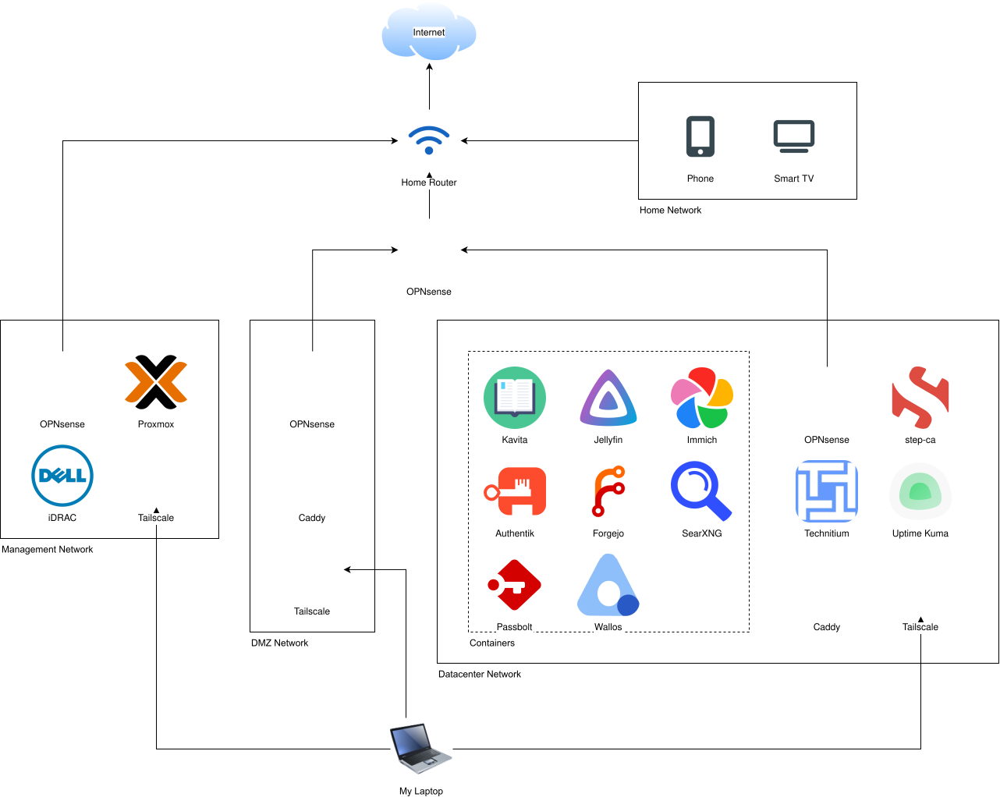

This past weekend [Nathan](https://linkedin.com/in/nathan-bledsoe-cyber) and I gave a talk on our homelabs at Rowdy CyberCon. It went really well, there were over 70 who came and watched the presentation, and I got a lot of great feedback from people who wanted to start a homelab but weren't sure where to start. I'm really happy with how it turned out! If you want to download the slides you can get them [here](homelabbing.pdf).

<!--truncate-->

It's been a while since I've talked about my homelab here so I thought I'd take this opportunity to give a quick update on the changes I've made. A lot has changed so this will only be a brief overview, mostly just expanding on what I went over in the talk in a little more detail.

Since my last homelab update I've essentially fully torn down my homelab and built it from scratch. Not a single VM from the last iteration still exists, and I've replaced lots of tools and services. I've also just changed the way I approach services in general. Before I was running pretty much one VM/LXC per service, but now I've switched to using Podman containers within a single VM. The benefits of this are twofold: more isolation from the hypervisor's OS, and easier deployment of services.

One of the biggest changes in terms of services is that I dropped FreeIPA. While it was definitely a beneficial learning experience, it was complete overkill for my homelab. I didn't need centralized authentication or shared home folders across every VM. So I ended up dropping it in favor of Authentik. So far this feels like the right choice, as I kept running into friction with FreeIPA that I haven't had yet with Authentik. I still get centralized auth for all the services I'm running, which will be helpful if I ever open up the services to my family members.

For somewhat similar reasons, I migrated from GitLab to Forgejo. GitLab was definitely overkill for my use case. Forgejo should be plenty for me, and it runs in a container, which made configuring it really easy. 

I also switched from pfSense to OPNsense. I don't remember the exact reason I migrated, but I much prefer the more modern looking UI of OPNsense, and the charts in the dashboard are a nice touch. This came alongside a new network structure, with 3 primary networks and a backbone network. I'm currently running 4 routers for this, but I'm considering consolidating some of them. I also separated the management interfaces out into their own network, so they shouldn't be reachable by any of the other devices. 

I've now spun up Kavita and Immich for books and photos alike. I've been liking them so far, but I haven't sat down and actually read a book with Kavita yet, and I haven't gotten Immich's facial recognition working yet either.

I also deployed Wallos, which lets you track subscription service spending. I've been liking it so far, but the admin user is just the first user to sign up with no way to change it, so I may need to redeploy or change the database manually so my user account isn't considered an admin.

I deployed SearXNG as well. I'm not sure how I'm feeling about it right now. It's nice that it aggregates several search engines, but it takes a few seconds to run a single search so most of the time I end up falling back to Google.

I also added Uptime Kuma so I can track when my services go down. It hasn't been super useful yet, partially because I haven't been keeping it up to date with new services as I've been adding them, but also because if something is down I can just hop into the box. It will probably become more useful if I open up the services to my family. 

There are few things that I migrated that I am considering migrating back though. I switched from bind9 to Technitium, and while the interface for Technitium is nice, I think I'd prefer to have git tracking over a nice UI, and I don't need the authentication features that Technitium has. I also switched to Caddy from Nginx, and while it has been incredible simple to use, I may switch back to Nginx for the more fine-grained control it provides, but I'm still undecided on that front since I haven't really run into any issues with Caddy so far.

I'm currently in the process of setting up Passbolt, but I left it sort of half completed and it's been a while since I've looked at it so I don't remember the current status off the top of my head. I think I was running into issues with Podman permissions or something similar, and trying to find a workaround.

But that's pretty much everything that has changed since the last update. I'll try to post about my lab more frequently again, especially once I start on the two big projects I have planned next: a SIEM and a cyber range. It could be a little bit before I get started on those though, since I've been mostly focusing my attention on Hecate recently. Speaking of which, in my last blog post I mentioned that I was going to go over some of the bugs I ran into when migrating Hecate from Lua to Typescript. That's still coming, but it might get delayed a bit more. I was busy with classwork and preparing for this presentation. Now, while my schedule has cleared up a bit, CCDC practices are starting to get into swing so it will all depend how much free time I have.
